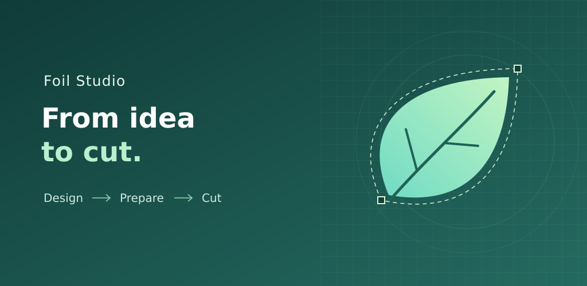

# Google Play assets

Original vector artwork, prepared 28 September 2026; captions and publication guidance reviewed 7 November 2026 for 0.1.127 (148). This release is in Google Play review; approval and rollout are pending. See the [version guide](../docs/release-notes.md). The icon matches the application's existing teal-and-white F launcher mark. The feature graphic extends the same palette with independently authored cutting-path artwork; it is not a screenshot or a promise of a particular physical result.

- `icon-512.png`: 512 × 512, RGBA PNG; store icon.
- `feature-1024x500.png`: 1024 × 500, RGB PNG; feature graphic.
- Editable SVG sources are included. They are graphic assets, not application code.

Feature graphic alt text: **Foil Studio: From idea to cut. A leaf-shaped cutting path illustrates the Design, Prepare, Cut workflow.**

Icon alt text: **White F on the teal Foil Studio background.**

Typography: DejaVu Sans. Graphics use no third-party photographs, device mockups, or customer artwork. These materials do not grant a licence to the proprietary application.

## Release maintenance

The icon and feature graphic remain generic Design, Prepare, Cut artwork. They do not show a version-specific control or promise compatibility with every plotter. For each Google Play release, match store text and screenshots to that released build, check all supported languages, verify dimensions and links, and keep unreleased features out of availability claims. See the [version guide](../docs/release-notes.md) and [screenshot inventory](../screenshots/README.md).

## Prepared 0.1.127 phone and tablet captures

[Open all eight screenshots and captions](0.1.127/README.md): four phone PNGs at 1080 × 1920 and four tablet PNGs at 2880 × 1620, all RGB without an alpha channel. The wide Design capture shows the layer/object tree. These are independent disconnected application renders, prepared for Google Play; they do not announce availability or prove physical cut quality.

## Current screenshot caption guidance

Use the fresh [0.1.127 sample inventory](../screenshots/README.md#current-01127-samples) for the new interface. Earlier development and archived images retain their dates and must not be relabelled as current captures. The generic icon and feature graphic remain unchanged.

- **English:** Assign material to layers, preview the selected Job in Cut, and continue the active design after returning to the app. Review and physical confirmations are required before production.
- **Polski:** Przypisz materiał do warstw, sprawdź podgląd wybranego zadania w Cięciu i kontynuuj bieżący projekt po powrocie do aplikacji. Przed produkcją wymagane są sprawdzenie i fizyczne potwierdzenia.
- **Deutsch:** Weise Ebenen Material zu, prüfe den gewählten Auftrag unter Schneiden und setze die aktuelle Gestaltung nach der Rückkehr fort. Vor der Produktion sind Prüfung und physische Bestätigungen erforderlich.
- **Español:** Asigna material a las capas, previsualiza el trabajo elegido en Cortar y continúa el diseño activo al volver a la aplicación. La producción requiere revisión y confirmaciones físicas.
