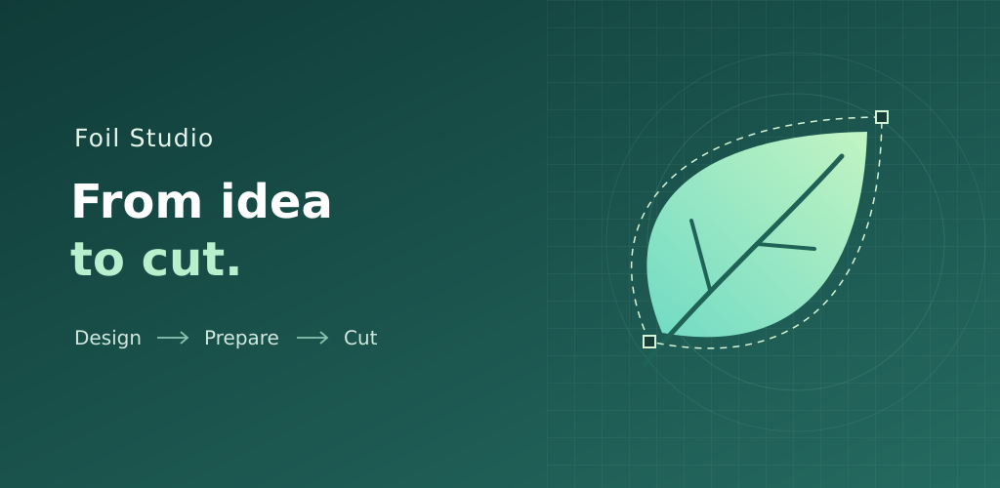

# Google Play assets

Original vector artwork, prepared 28 September 2026; captions reviewed 15 November 2026 for 0.1.145 (166). Submitted to Google Play for production review on 15 November 2026, with full rollout requested after approval. Play Console shows changes in review. Approval and public availability of 0.1.145 are not yet confirmed. The last confirmed available production version is 0.1.129 (150), available since 9 November 2026. See the [version guide](../docs/release-notes.md). The icon matches the application's existing teal-and-white F launcher mark. The feature graphic extends the same palette with independently authored cutting-path artwork; it is not a screenshot or a promise of a particular physical result.

- `icon-512.png`: 512 × 512, RGBA PNG; store icon.
- `feature-1024x500.png`: 1024 × 500, RGB PNG; feature graphic.
- Editable SVG sources are included. They are graphic assets, not application code.

Feature graphic alt text: **Foil Studio: From idea to cut. A leaf-shaped cutting path illustrates the Design, Prepare, Cut workflow.**

Icon alt text: **White F on the teal Foil Studio background.**

Typography: DejaVu Sans. Graphics use no third-party photographs, device mockups, or customer artwork. These materials do not grant a licence to the proprietary application.

## Release maintenance

The icon and feature graphic remain generic Design, Prepare, Cut artwork. They do not show a version-specific control or promise compatibility with every plotter. For each Google Play release, match store text and screenshots to that released build, check all supported languages, verify dimensions and links, and keep unreleased features out of availability claims. See the [version guide](../docs/release-notes.md) and [screenshot inventory](../screenshots/README.md).

## Retained 0.1.129 phone and tablet captures

[Open all eight screenshots and captions](0.1.129/README.md): four phone PNGs at 1080 × 1920 and four tablet PNGs at 2880 × 1620, all RGB without an alpha channel. The wide Design capture shows the layer/object tree. These are independent disconnected application renders, prepared for Google Play; they do not announce availability or prove physical cut quality.

## Current screenshot caption guidance

Use the fresh [0.1.129 sample inventory](../screenshots/README.md#retained-01129-samples) for the documented 0.1.129 interface. Earlier development and archived images retain their dates and must not be relabelled as current captures. The generic icon and feature graphic remain unchanged.

- **English:** Assign material to layers, preview the selected Job in Cut, and continue the active design after returning to the app. Review jobs in Prepare; select a Job and Start cutting in Cut, then complete the physical confirmations.
- **Polski:** Przypisz materiał do warstw, sprawdź podgląd wybranego zadania w Cięciu i kontynuuj bieżący projekt po powrocie do aplikacji. Sprawdź zadania w Przygotowaniu; w Cięciu wybierz Zadanie i Rozpocznij cięcie, a następnie potwierdź warunki fizyczne.
- **Deutsch:** Weise Ebenen Material zu, prüfe den gewählten Auftrag unter Schneiden und setze die aktuelle Gestaltung nach der Rückkehr fort. Prüfe Aufträge unter Vorbereiten; wähle unter Schneiden den Auftrag und Schneiden starten und bestätige die physischen Bedingungen.
- **Español:** Asigna material a las capas, previsualiza el trabajo elegido en Cortar y continúa el diseño activo al volver a la aplicación. Revisa trabajos en Preparar; elige Trabajo e Iniciar corte en Cortar y completa las confirmaciones físicas.

## 0.1.145 caption review

The retained images are explicitly dated 0.1.129 captures. They illustrate Design, Prepare, Cut and layer material assignment, not the new Machine control picker or GCC qualification. The one-row picker, USB device information and GCC workflows are described in the current manuals. Generic icon/feature artwork and the listed four-language captions remain applicable; no historical image is relabelled as a new capture.
